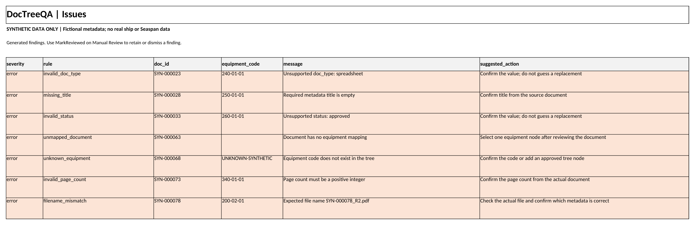
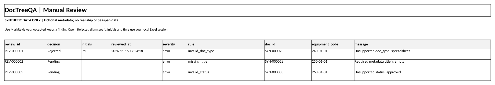
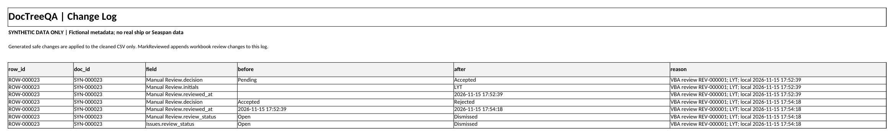
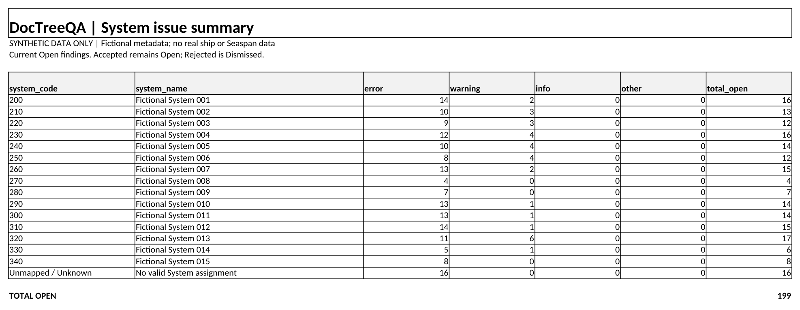

# DocTreeQA

[](https://github.com/DDDYT24/DocTreeQA/actions/workflows/ci.yml)

DocTreeQA checks a technical document register against an equipment tree and
creates an Excel report for human review. It helps answer: where does a document
belong, is its metadata valid, and which required document types are missing?

**All data is synthetic.** No real ship or Seaspan records, drawings or
proprietary equipment structures are included.

## Quick start

Install [uv](https://docs.astral.sh/uv/getting-started/installation/), then run
these commands from the project folder:

```sh
uv sync --locked --extra dev
uv run doctree check
uv run doctree report --force
```

Open `reports/doctree_report.xlsx` to inspect Summary, Issues, Completeness,
Manual Review and Change Log. The report uses white backgrounds, black text and
ordinary black table borders; see [the style guide](docs/style.md).

`report` runs fresh checks and `--force` replaces the generated workbook. Keep
reviewer decisions in a separate `.xlsm` copy. To regenerate the example inputs,
run `uv run doctree generate --force` before checking them.

## What it checks

- Valid parents, consistent levels and cycles in System > Subsystem > Equipment.
- Document mappings, required metadata, allowed values, dates and file names.
- Duplicate records, similar titles and revision status conflicts.
- Required document type coverage, rolled up through the equipment tree.

Only whitespace and document type casing are corrected automatically. Every
change is logged. Duplicate candidates and other uncertain findings go to
manual review. The validator does not read the injected fault log; a separate
scorer compares its findings with that log afterward.

## Results

<!-- RESULTS:START -->
| Measure | Saved value |
| --- | --- |
| Equipment items | 300 |
| Document register rows | 3008 |
| Findings requiring review | 200 |
| Logged safe changes | 16 |
| Required type coverage | 772 / 780 (98.9744%) |
| Overall synthetic precision | 100.00% |
| Overall synthetic recall | 100.00% |
| Measured runtime, seconds | 0.062144 |
| Passing local pytest cases | 160 |

Scores cover controlled synthetic faults, including safe changes. [Full per-rule results](docs/results.md) include rules without injected examples.
<!-- RESULTS:END -->

See [the detailed results](docs/results.md) for per-rule scores, calculation
scope and evidence links. Synthetic benchmark results do not establish accuracy
on a real document archive. Completeness measures issued metadata coverage, not
the correctness of document content.

## Review in Excel

Python performs the bulk checks. The exported [VBA module](vba/DocTreeQA.bas)
lets an Excel reviewer work inside the workbook:

| Macro | Action |
| --- | --- |
| `HighlightIssues` | Colours issue rows by severity and enables filters. |
| `BuildSystemSummary` | Groups current open findings by System, including unmapped findings. |
| `MarkReviewed` | Records a decision, initials and time, synchronizes the finding status and appends an audit entry. |

Accepted retains a finding as Open for follow-up. Rejected marks it Dismissed;
the finding and its history remain available. The generated baseline and saved
review decisions are separate datasets.

Follow [the Excel walkthrough](docs/excel_walkthrough.md) for a fresh setup.
The supplied review workbook retains its original embedded module. To use the
updated plain table style when rebuilding summaries, replace that module using
[the module update guide](docs/update_review_module.md). The revised module's
presentation changes have not been retested in Windows.

The original main workflow was verified in a user-run Windows Excel session.
See [the acceptance record](docs/windows_acceptance.md) for what was observed
and what remains outside that evidence.

<!-- WINDOWS:START -->
| Recorded Windows Excel result | Value |
| --- | --- |
| Test date | 2026-11-15 |
| Excel version | 2610 |
| Excel build | 16.0.20527.20196 |
| Excel bitness | 64 |
| Open findings after rejection | 199 |
| Open findings after reopening | 199 |
| Added review audit rows | 7 |
<!-- WINDOWS:END -->

## Workbook demonstration

These images are rendered from the actual uploaded review workbook with the
updated presentation style. They show its saved review state, rather than a new
Windows macro execution. Click an image to inspect it at full size.

| Issues | Manual review |
| --- | --- |
| [](docs/screenshots/issues_review.png) | [](docs/screenshots/manual_review.png) |
| Review audit | System summary |
| [](docs/screenshots/review_audit.png) | [](docs/screenshots/system_summary.png) |

## Tests and limits

```sh
uv run ruff check .
uv run ruff format --check .
uv run pytest
```

GitHub Actions runs these checks on pushes and pull requests. Tests cover the
validation rules, deterministic generation, scoring, safe changes and workbook
structure. CI does not execute VBA; Windows observations are recorded separately.

The tool checks metadata, not PDF contents or P&IDs. Title similarity identifies
review candidates and does not prove identical content. Numeric revisions and
equipment class naming rules would need adaptation for a real register. This
project is a document QA exercise, not an archive management or approval system.
