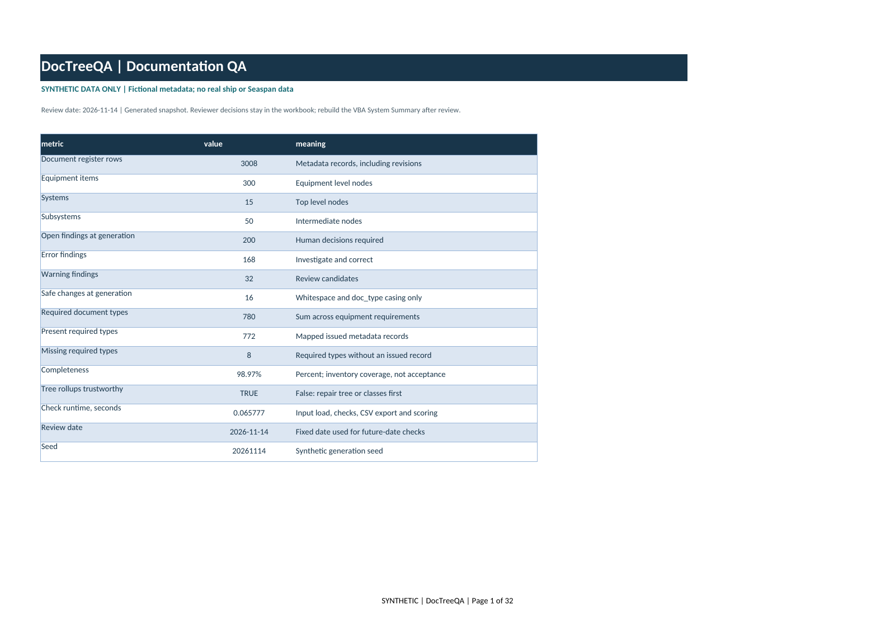

# DocTreeQA

[](https://github.com/DDDYT24/DocTreeQA/actions/workflows/ci.yml)

DocTreeQA checks a technical document register against an equipment hierarchy.
It identifies metadata errors, mapping problems and gaps in required document
types, then saves findings for a human reviewer.

All data is synthetic and generated with a fixed seed. This project contains no
real ship or Seaspan data, company drawings, logos or proprietary equipment
structures. It is a portfolio exercise in document control and data validation.

## Document control workflow

The equipment tree uses System, Subsystem and Equipment levels. Each document
record should map to a unique Equipment node. The tool checks the tree before
assessing mappings, metadata and document type completeness.

The generator first builds a complete register with valid revision histories,
then injects recorded faults. The validator runs without reading the injection
log. A separate scorer compares its findings with that log after validation.
Consequences such as a missing replacement for a superseded revision are recorded
alongside the mutation that caused them.

Outputs include CSV, JSON and an Excel review workbook. The command line,
generator, validation, scoring and workbook export are implemented. The VBA
module is written and has passed a grammar syntax check; compilation and
execution in Windows Excel remain pending.

## Setup

Install [uv](https://docs.astral.sh/uv/getting-started/installation/), open a
terminal in the repository root, and run:

```sh
uv sync --locked --extra dev
```

The project interpreter is selected by `.python-version`. Dependencies are
recorded in `uv.lock`. A standard virtual environment and an editable install
with `pip install -e '.[dev]'` also work with a compatible Python interpreter.

## Run

The repository includes saved synthetic inputs and their results. To inspect
those inputs without replacing them:

```sh
uv run doctree check
```

To regenerate them from the fixed seed, then rerun the checks:

```sh
uv run doctree generate --force
uv run doctree report --force
```

`generate` refuses to replace existing inputs unless `--force` is supplied.
`report` reruns validation before building `reports/doctree_report.xlsx`.
It also refuses to replace an existing workbook unless `--force` is supplied.
Keep reviewer decisions in a separate `.xlsm` copy; regeneration creates a new
snapshot and does not import existing reviewer decisions.
Use `doctree --config /absolute/path/to/configs/default.yaml check` when running
from another directory. Paths in the configuration are relative to the project
directory containing `configs`, and can also be absolute.

`check` completes successfully when it writes the results, even when it finds
problems. Use `check --fail-on-issues` to return a failing process status when
findings exist. Input or configuration errors return a separate failure status.

## Checks and review decisions

- Tree checks cover missing codes or names, duplicate codes, invalid parents,
  inconsistent levels and cycles. Ambiguous equipment mappings are flagged.
- Metadata checks cover required values, allowed document types and statuses,
  numeric revisions, positive page counts, strict calendar dates and the
  configured file naming rule. Future dates use the fixed review date in the
  configuration, so rerunning the example later does not change its meaning.
- Document identity is the document ID across revisions. A repeated document ID
  at the same numeric revision is flagged. Distinct historical revisions are
  allowed. Multiple issued revisions and superseded revisions without a newer
  issued replacement need review.
- Exact duplicate records, shared file names under different document IDs and
  similar titles are review candidates. Title comparison normalizes text and
  uses `SequenceMatcher` within the same equipment and document type. Shared
  names do not prove that file contents are identical.
- Completeness counts distinct required document types with an issued record
  mapped to each equipment item. Parent percentages use total required types as
  the denominator. A metadata error can coexist with a present document type;
  the completeness figure is an inventory measure, not content acceptance.

Only surrounding whitespace and document type casing are corrected
automatically. Every change has a before value and an after value. The original
register is preserved. Findings remain open for human decisions.

`row_id` identifies a source record independently of document ID and revision.
If it is absent from an external register, it is derived from source row order;
retain that order when comparing results with a separate ground truth file.
Equipment classes in the example are identified by the first word of each
equipment name, with required types listed in `data/required_docs.csv`.

## Saved results

<!-- RESULTS:START -->
| Measure | Saved value |
| --- | --- |
| Python runtime | 3.11.18 |
| Systems | 15 |
| Subsystems | 50 |
| Equipment items | 300 |
| Document register rows | 3008 |
| Findings requiring review | 200 |
| Logged safe changes | 16 |
| Required type coverage | 772 / 780 (98.9744%) |
| Scored expected findings, including safe changes | 216 |
| Overall synthetic precision | 100.00% |
| Overall synthetic recall | 100.00% |
| False positives | 0 |
| False negatives | 0 |
| Measured runtime, seconds | 0.065777 |
| Passing local pytest cases | 160 |
| Workbook sheets | 5 |

Per-rule results with injected examples:

| Rule | Expected | Detected | Precision | Recall |
| --- | --- | --- | --- | --- |
| `duplicate_doc_id` | 8 | 8 | 100.00% | 100.00% |
| `duplicate_file` | 8 | 8 | 100.00% | 100.00% |
| `exact_duplicate` | 8 | 8 | 100.00% | 100.00% |
| `filename_mismatch` | 16 | 16 | 100.00% | 100.00% |
| `future_date` | 8 | 8 | 100.00% | 100.00% |
| `invalid_date` | 8 | 8 | 100.00% | 100.00% |
| `invalid_doc_type` | 8 | 8 | 100.00% | 100.00% |
| `invalid_page_count` | 8 | 8 | 100.00% | 100.00% |
| `invalid_revision` | 8 | 8 | 100.00% | 100.00% |
| `invalid_status` | 8 | 8 | 100.00% | 100.00% |
| `missing_required` | 8 | 8 | 100.00% | 100.00% |
| `missing_revision` | 8 | 8 | 100.00% | 100.00% |
| `missing_title` | 8 | 8 | 100.00% | 100.00% |
| `multiple_issued` | 8 | 8 | 100.00% | 100.00% |
| `near_duplicate_title` | 16 | 16 | 100.00% | 100.00% |
| `safe_normalization` | 16 | 16 | 100.00% | 100.00% |
| `superseded_without_replacement` | 40 | 40 | 100.00% | 100.00% |
| `unknown_equipment` | 8 | 8 | 100.00% | 100.00% |
| `unmapped_document` | 8 | 8 | 100.00% | 100.00% |
| `wrong_mapping_level` | 8 | 8 | 100.00% | 100.00% |

Other rules have no injected examples in the default benchmark; their recall is N/A in the scoring JSON. Numeric results above come from the saved summary, scoring and test XML files. Rerun `python scripts/update_readme_results.py` after updating those outputs.
<!-- RESULTS:END -->

See [summary](reports/summary.json), [per-rule scoring](reports/scoring.json),
[findings](reports/issues.csv), [completeness](reports/completeness.csv),
[manual review queue](reports/manual_review.csv) and [change log](reports/change_log.csv).
Runtime includes loading, validation, CSV export and scoring, and excludes the
final summary write and Excel export. It is a local measurement, not a
production benchmark. Workbook counts, source hashes and review semantics are
saved in [the workbook manifest](reports/workbook_manifest.json).

## Tests and CI

```sh
uv run ruff check .
uv run ruff format --check .
uv run pytest --junitxml=reports/pytest-results.xml
```

Handmade fixtures test passing and failing cases, revision boundaries, cycles,
weighted completeness, normalization and scoring mistakes. Integration tests
cover deterministic generation, alternate seeds, a clean register, missing
ground truth, CLI behavior and saved output schemas. Removing the answer key
does not change detector findings.

Workbook tests check sheet names, table headers, row counts, numeric percentages,
source values, hierarchy order, safe text export and preservation of existing
review copies. Static checks compare VBA table and column references against an
actual exported workbook. They do not execute macros. Optional syntax validation
is described in [the validation notes](docs/validation.md).

The GitHub Actions workflow uses the locked dependencies and runs lint,
formatting and pytest on pushes and pull requests. Local checks and the saved
hosted run have passed. The badge links to current workflow results. Saved status records are listed in
[publication status](reports/publication.json) and [CI status](reports/ci_status.json).
The remaining publication step is described in [the publishing guide](docs/publish.md).

## Excel and VBA

Python handles bulk validation and creates the workbook. VBA supports review
inside Excel, so a reviewer can work without running Python:

- `HighlightIssues` colours Issues rows by severity and enables filter arrows.
- `BuildSystemSummary` creates a summary of current open findings by System,
  including an Unmapped / Unknown group.
- `MarkReviewed` records Accepted or Rejected decisions, initials and a local
  timestamp on visible selected Manual Review rows. It synchronizes the matching
  finding in Issues and appends changed fields to Change Log.

Accepted retains a finding as Open for follow-up. Rejected marks it Dismissed;
the finding remains in the workbook. These decisions do not correct source
metadata. Summary retains its generated counts; rerun BuildSystemSummary for
current open counts after review.

The initial `.xlsx` contains Summary, Issues, Completeness, Manual Review and
Change Log. Import [the module](vba/DocTreeQA.bas) into a separate `.xlsm` copy
using [the Windows Excel instructions](docs/excel_walkthrough.md).
[Reference counts](reports/excel_acceptance_reference.json) are calculated by
Python for comparison during that test; they are not proof that VBA ran.
Record observed results in [the acceptance record](docs/windows_acceptance.md).

The module has passed the recorded syntax check. Windows Excel compilation,
macro execution and save/reopen verification are pending. Successful runtime
operation must not be claimed until those steps have been observed.

## Limitations

The example uses controlled synthetic faults. Perfect recovery on those faults
does not establish performance on a real archive. Rules without injected
examples have no synthetic recall estimate, even when unit tests cover them.
Title similarity retrieves candidates for manual review; it cannot establish
that documents are duplicates.

The tool checks metadata and naming conventions. It does not open PDFs, inspect
content, calculate document content hashes or read P&IDs. Its numeric revision convention and
equipment class naming convention would need adaptation for an actual register.
Tree or class errors mark completeness as untrustworthy. This is not a document
management system, and it does not provide approval or archive access controls.

## Screenshots

The preview below is rendered from the actual `.xlsx` with LibreOffice in the
cloud. It checks workbook layout and does not show macro execution.



Windows Excel macro screenshots remain pending a manual run. No macro execution
results or interface screenshots are simulated.
